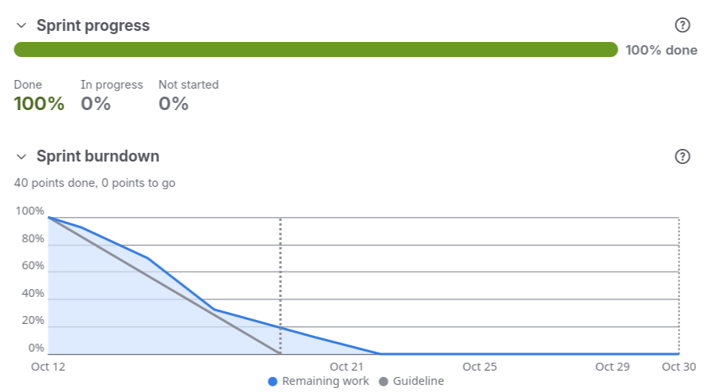
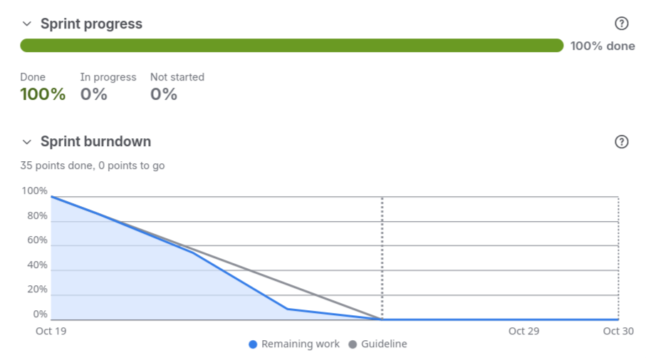
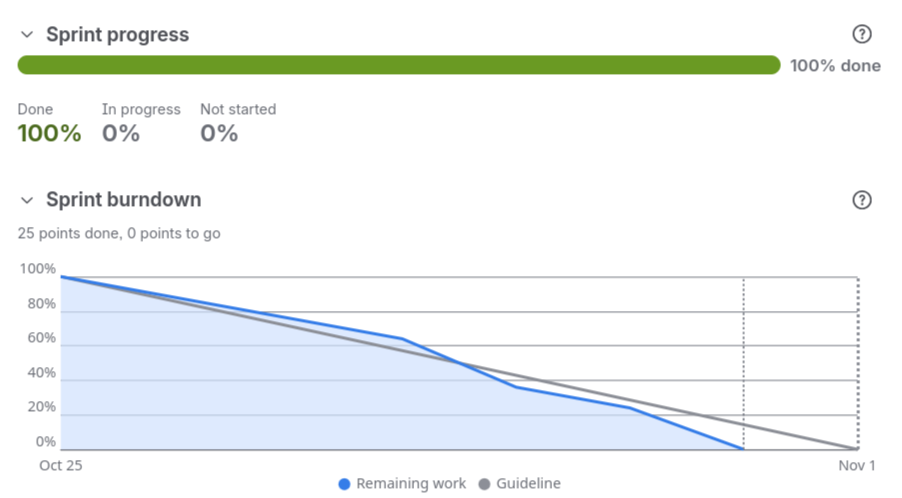

# KAN-18 — Jira and burndown evidence

## 1. Sprint overview

| Sprint | Dates        | Sanskar     | Peter      | Chester    | Reyon      | Maaz           |
| ------ | ------------ | ----------- | ---------- | ---------- | ---------- | -------------- |
| 1      | 12–19 Oct    | KAN-2, 3, 4 | KAN-7, 8   | KAN-13, 14 | KAN-19, 20 | KAN-25, 26, 27 |
| 2      | 19–26 Oct    | KAN-31      | KAN-9, 10  | KAN-15, 16 | KAN-21, 22 | KAN-28, 29     |
| 3      | 26 Oct–1 Nov | KAN-5, 6    | KAN-11, 12 | KAN-17, 18 | KAN-23, 24 | KAN-30         |

---

## 2. Sprint 1 (12–19 October)

### Board snapshot

| Ticket | Owner   | Status at start | Status at end | Notes                                           |
| ------ | ------- | --------------- | ------------- | ----------------------------------------------- |
| KAN-2  | Sanskar | To Do           | Done          | Natural-language intake and confirmation        |
| KAN-3  | Sanskar | To Do           | Done          | Constrained baskets and goal choices            |
| KAN-4  | Sanskar | To Do           | Done          | Meal plans from accepted baskets                |
| KAN-7  | Peter   | To Do           | Done          | Solver contract and feasibility fixtures        |
| KAN-8  | Peter   | To Do           | Done          | Safe substitutions with user acceptance         |
| KAN-13 | Chester | To Do           | Done          | Product and pricing data contract               |
| KAN-14 | Chester | To Do           | Done          | Multi-retailer ingestion and unit normalisation |
| KAN-19 | Reyon   | To Do           | Done          | Compliance verdicts and adversarial fixtures    |
| KAN-20 | Reyon   | To Do           | Done          | Cascading allergen and dietary checks           |
| KAN-25 | Maaz    | To Do           | Done          | Deployment, profile and audit interfaces        |
| KAN-26 | Maaz    | To Do           | Done          | Accounts and household dietary profiles         |
| KAN-27 | Maaz    | To Do           | In Progress   | Grounded explanations and audit review          |

### Key commits

| Commit    | Date       | Author  | Ticket  | Description                                                               |
| --------- | ---------- | ------- | ------- | ------------------------------------------------------------------------- |
| `2533083` | 2026-10-14 | Maaz    | —       | Project skeleton — agents, API, frontend, CI                              |
| `47149e9` | 2026-10-14 | Maaz    | KAN-25  | Agree household, permission, audit and review-case interfaces             |
| `5c55249` | 2026-10-14 | Peter   | KAN-7   | Add deterministic small-catalogue fixtures and solver spike               |
| `ecb1dc9` | 2026-10-14 | Peter   | KAN-7   | Document the optimiser interface contract                                 |
| `a61a17d` | 2026-10-14 | Peter   | KAN-7   | Test the optimiser contract against the fixtures                          |
| `2088b91` | 2026-10-14 | Peter   | KAN-7   | Flag solver timeouts separately from infeasibility                        |
| `8ee461e` | 2026-10-13 | Maaz    | KAN-25  | Record framework, AI integration and deployment decisions                 |
| `7cc4db0` | 2026-10-15 | Maaz    | KAN-26  | Validate household edits before saving                                    |
| `e64b4c7` | 2026-10-15 | Chester | KAN-13  | Complete product and pricing data contract                                |
| `32f5978` | 2026-10-16 | Sanskar | KAN-2   | Validate intake corrections and require clarification before confirmation |
| `26d4ccf` | 2026-10-16 | Sanskar | KAN-3   | Gate basket acceptance on current validated constraints                   |
| `96e8174` | 2026-10-16 | Sanskar | KAN-3   | Reject conflicting and unavailable product quantities                     |
| `6351829` | 2026-10-16 | Chester | KAN-14  | Build multi-retailer ingestion and unit normalisation                     |
| `3950abb` | 2026-10-16 | Maaz    | KAN-26  | Test profile lifecycle, multi-member restrictions and access              |
| `899e51f` | 2026-10-17 | Sanskar | KAN-3/4 | Share exact meal counts between baskets and plans                         |
| `db0b602` | 2026-10-17 | Sanskar | KAN-4   | Allocate meal ingredients without reusing or expiring stock               |
| `67739b1` | 2026-10-18 | Sanskar | KAN-4   | Require accepted current baskets for meal planning                        |
| `b65cc7d` | 2026-10-18 | Sanskar | KAN-4   | Guide basket acceptance and explain meal coverage                         |
| `942a921` | 2026-10-19 | Maaz    | KAN-27  | Ground explanations in recorded constraints, prices and verdicts          |
| `092af2d` | 2026-10-19 | Peter   | KAN-8   | Propose flagged items for their reason in the substitution drawer         |
| `77abd29` | 2026-10-19 | Peter   | KAN-8   | Test accept, reject, repeated rejection, unsafe and no-alternative swaps  |
| `f247a4b` | 2026-10-19 | Peter   | KAN-8   | Re-check a swap's safety before applying it                               |
| `5766d3e` | 2026-10-19 | Reyon   | KAN-19  | Specify compliance verdict contract and adversarial fixtures              |
| `5e2b0ff` | 2026-10-19 | Reyon   | KAN-20  | Withhold corrupt, cyclic and empty ingredient data                        |
| `10948ac` | 2026-10-19 | Reyon   | —       | Merge PR #2 — KAN-19                                                      |

### Scope changes and blockers

No scope changes in Sprint 1. All tickets were delivered within the sprint window. KAN-27 carried
over into Sprint 2 for completion of the frontend explanation view.

---

## 3. Sprint 2 (19–26 October)

### Board snapshot

| Ticket | Owner   | Status at start | Status at end | Notes                                                 |
| ------ | ------- | --------------- | ------------- | ----------------------------------------------------- |
| KAN-27 | Maaz    | In Progress     | Done          | Grounded explanations (carry-over from Sprint 1)      |
| KAN-31 | Sanskar | To Do           | Done          | Docker image and CI/CD pipeline                       |
| KAN-9  | Peter   | To Do           | Done          | Infeasibility negotiation                             |
| KAN-10 | Peter   | To Do           | Done          | Cautious buy-timing advice                            |
| KAN-15 | Chester | To Do           | Done          | Named-baseline savings comparisons                    |
| KAN-16 | Chester | To Do           | Done          | Conversational basket editing                         |
| KAN-21 | Reyon   | To Do           | Done          | Nutritional coverage checks                           |
| KAN-22 | Reyon   | To Do           | Done          | Editable taste and preference memory                  |
| KAN-28 | Maaz    | To Do           | Done          | Authorised human review queue                         |
| KAN-29 | Maaz    | To Do           | In Progress   | Reproducible clean deployment (carried into Sprint 3) |

### Key commits

| Commit    | Date       | Author  | Ticket | Description                                                                   |
| --------- | ---------- | ------- | ------ | ----------------------------------------------------------------------------- |
| `7017bd2` | 2026-10-20 | Maaz    | KAN-27 | Show records behind each explanation and name missing evidence                |
| `df9bce2` | 2026-10-20 | Chester | —      | Merge PR #3 — KAN-13/14                                                       |
| `4d3ee7b` | 2026-10-21 | Chester | KAN-15 | Named-baseline savings comparisons — tests, UI polish and catalogue specials  |
| `13d1f65` | 2026-10-21 | Sanskar | KAN-31 | Wait for Docker server readiness before smoke tests                           |
| `c7f8bee` | 2026-10-21 | Sanskar | KAN-31 | Set up Docker image publishing and CI/CD                                      |
| `765ab51` | 2026-10-21 | Peter   | KAN-10 | State the history and wait date behind buy-timing advice                      |
| `b18f56d` | 2026-10-21 | Peter   | KAN-10 | Test history sufficiency, perishable exclusion and demo labelling             |
| `33f7c42` | 2026-10-21 | Reyon   | KAN-21 | Check staples and scaled nutrition targets, suggest compliant repairs         |
| `edd75ac` | 2026-10-21 | Maaz    | KAN-28 | Restrict case assignment to authorised reviewers                              |
| `10f9b65` | 2026-10-22 | Chester | KAN-15 | Fix basket summary width and budget bar jitter on tab switch                  |
| `f8a9dcd` | 2026-10-22 | Chester | KAN-15 | Expand catalogue specials and seed data                                       |
| `57c94cb` | 2026-10-22 | Chester | —      | Merge PR #6 — KAN-15                                                          |
| `0b3fcd0` | 2026-10-23 | Peter   | KAN-9  | Keep hard constraints and report timeouts while searching for trade-offs      |
| `dcbe626` | 2026-10-23 | Peter   | KAN-9  | Let the shopper cancel negotiation and accept only budget, days or goal       |
| `031b7a6` | 2026-10-23 | Reyon   | KAN-22 | Edit and forget remembered preferences, keep preference text out of audit log |
| `f482ab9` | 2026-10-23 | Reyon   | —      | Merge PR #7 — KAN-22                                                          |
| `62efcc3` | 2026-10-24 | Chester | KAN-16 | Send example prompts immediately and centre chat suggestion chips             |
| `622f925` | 2026-10-24 | Chester | KAN-16 | Expand seed catalogue to 105 products with full nutrition coverage            |
| `2390fa5` | 2026-10-24 | Chester | KAN-16 | Restore PRO-MAL-BAR and PRO-DIS-STEAK test fixtures                           |
| `21379ae` | 2026-10-24 | Chester | —      | Merge PR #8 — KAN-16                                                          |
| `57f5e34` | 2026-10-26 | Maaz    | KAN-29 | Label offline and fallback AI modes and test missing keys and network failure |
| `7545a61` | 2026-10-26 | Maaz    | KAN-29 | Pin backend dependencies to tested versions                                   |
| `87df07f` | 2026-10-26 | Maaz    | KAN-29 | Add clean-source build and startup verification script                        |

### Scope changes

**Catalogue expansion (KAN-16, 24 October)**
The initial KAN-16 implementation used the existing 47-product catalogue. During development it
became apparent that 47 products provided insufficient coverage for realistic conversational edits.
The catalogue was expanded to **105 products** with full nutrition coverage and 70% specials.
Absorbed within the story estimate as a supporting data change.

### Changes made before merging

**KAN-15 PR:**

1. Budget bar in the basket summary had a visible jitter when switching tabs. Fixed in `10f9b65`.
2. Catalogue specials percentage (initially 50%) was insufficient for meaningful retailer price
   variation in the demo. Expanded to 70% specials in `f8a9dcd`.

**KAN-16 PR:**

1. Chat suggestion chips were not displayed until after the first server round-trip. Fixed in `62efcc3`.
2. `PRO-MAL-BAR` and `PRO-DIS-STEAK` test fixtures missing after catalogue expansion. Restored in `2390fa5`.

---

## 4. Sprint 3 (26 October – 1 November)

### Board snapshot (mid-sprint check, 28–29 October)

| Ticket | Owner   | Status on 28 Oct | Status on 29 Oct | Notes                                  |
| ------ | ------- | ---------------- | ---------------- | -------------------------------------- |
| KAN-5  | Sanskar | In Progress      | Done             | Shopper-journey integration            |
| KAN-6  | Sanskar | In Progress      | Done             | Investor demo coordination             |
| KAN-11 | Peter   | In Progress      | In Progress      | Failure-path matrix (merged 30 Oct)    |
| KAN-17 | Chester | In Progress      | Done             | Price and edit verification            |
| KAN-18 | Chester | In Progress      | In Progress      | This document (merged to close)        |
| KAN-23 | Reyon   | In Progress      | Done             | Safety regression evaluation           |
| KAN-24 | Reyon   | In Progress      | Done             | Safety evidence and contribution       |
| KAN-29 | Maaz    | Done             | Done             | Clean deployment and offline labelling |
| KAN-30 | Maaz    | In Progress      | Done             | Submission archive and checklist       |

### Ticket-status timeline

| Date         | Tickets closed    | Tickets still open                   | Event                                              |
| ------------ | ----------------- | ------------------------------------ | -------------------------------------------------- |
| 26 Oct       | —                 | KAN-5, 6, 11, 17, 18, 23, 24, 29, 30 | Sprint 3 begins                                    |
| 26–27 Oct    | KAN-29            | KAN-5, 6, 11, 17, 18, 23, 24, 30     | KAN-17 bug fix committed; merge conflicts resolved |
| 28 Oct       | KAN-5, 17, 23, 24 | KAN-6, 11, 18, 30                    | UAT run; four tickets closed end of day            |
| 29 Oct       | KAN-6, 30         | KAN-11, 18                           | Submission archive and release guidance closed     |
| 30 Oct       | KAN-11            | KAN-18                               | Failure-path matrix merged                         |
| 31 Oct–1 Nov | KAN-18            | —                                    | This document closed; sprint complete              |

### Key commits

| Commit    | Date       | Author  | Ticket | Description                                                          |
| --------- | ---------- | ------- | ------ | -------------------------------------------------------------------- |
| `7c792b8` | 2026-10-27 | Chester | KAN-17 | Fix split-basket completeness bug and harden test coverage           |
| `5e2494d` | 2026-10-28 | Maaz    | KAN-30 | Package submission archive, manifest and secret scan                 |
| `5582e84` | 2026-10-28 | Reyon   | KAN-23 | Safety evaluation and allergen seed fixes                            |
| `682c7a7` | 2026-10-28 | Reyon   | KAN-24 | Safety demo segment, chat refusal naming and contribution statement  |
| `d826df3` | 2026-10-28 | Sanskar | KAN-5  | Shopper acceptance fixes and release verification                    |
| `68dbedc` | 2026-10-29 | Maaz    | KAN-30 | Submission checklist and contribution statement draft                |
| `5017d24` | 2026-10-29 | Sanskar | KAN-23 | Prevent unsafe extras returning after quantity edits                 |
| `07af6b7` | 2026-10-29 | Sanskar | KAN-6  | Refresh main documentation and release guidance                      |
| `94c54dd` | 2026-10-29 | Maaz    | KAN-30 | Record v1.0.0-rc1 archive rehearsal, checksum and clean-run evidence |
| `64c1fb1` | 2026-10-30 | Peter   | KAN-11 | Record integration defects, owners and retest plan                   |
| `f89c5f8` | 2026-10-30 | Peter   | KAN-11 | Add negotiation, substitution and buy-timing failure-path matrix     |

### Scope changes and blockers

**Blocker: KAN-17 split-basket bug (27 October)**
A correctness defect in `services/pricing/split_basket.py` caused baskets with single-store products
to under-report their total. Blocked the KAN-17 PR until fixed in commit `7c792b8`.

**Blocker: Integration merge conflicts (27 October)**
Maaz's KAN-29 changes to `llm/service.py` and Sanskar's KAN-5 changes to `workflows/basket_editing.py`
needed resolution before KAN-17 could be based on the latest main. Resolved via rebase before raising the PR.

**Integration defects absorbed on 28 October (UAT, KAN-5)**

- Stale pantry-edit explanations referencing old prices after a basket rebuild (fixed in KAN-5 by Sanskar).
- The `parse_edit` task's specific-product matching bypassing the compliance screen (fixed in KAN-23 by Reyon).
- Edit change summary and basket receipt showing different totals with pantry extras (fixed same day, evidenced in UAT record `$81.54`).

---

## 5. Burndown charts (Jira exports)

| Sprint                  | Snapshot                                            |
| ----------------------- | --------------------------------------------------- |
| Sprint 1 (12–19 Oct)    |  |
| Sprint 2 (19–26 Oct)    |  |
| Sprint 3 (26 Oct–1 Nov) |  |

---

## 6. Iteration review and velocity

**Velocity (Chester's tickets):**

- Sprint 1 (12–19 Oct): KAN-13, KAN-14 delivered (2 stories)
- Sprint 2 (19–26 Oct): KAN-15, KAN-16 delivered (2 stories)
- Sprint 3 (26 Oct–1 Nov): KAN-17, KAN-18 closed (2 stories + integration bug fixes)

**Sprint 3 team delivery:**

- KAN-5/6 (Sanskar): integrated shopper journey and release guidance closed.
- KAN-11 (Peter): failure-path matrix closed 30 October.
- KAN-23/24 (Reyon): safety regression evaluation and evidence closed.
- KAN-29/30 (Maaz): clean deployment evidence and submission archive closed.

---

## 7. Completed work links (for contribution form)

All links are to the canonical `rkn321/ELEC5620-Group5-TrolleyMate` repository.

| Ticket | Sprint | Merge commit           | PR                  | Files changed                                                                                                                                                                                                              |
| ------ | ------ | ---------------------- | ------------------- | -------------------------------------------------------------------------------------------------------------------------------------------------------------------------------------------------------------------------- |
| KAN-13 | 1      | `e64b4c7` (2026-10-15) | PR #3               | `backend/app/services/pricing/`, `backend/app/api/pricing.py`, `backend/app/seed/catalogue.json`, `backend/tests/test_catalogue.py`, `backend/tests/test_pricing.py`                                                       |
| KAN-14 | 1      | `6351829` (2026-10-16) | PR #3               | `backend/app/services/pricing/ingest.py`, `backend/app/services/pricing/normalise.py`, `backend/tests/test_ingest.py`                                                                                                      |
| KAN-15 | 2      | `57c94cb` (2026-10-22) | PR #6               | `backend/app/workflows/basket_builder.py`, `backend/app/api/baskets.py`, `frontend/src/features/pricing/`, `backend/tests/test_savings.py`                                                                                 |
| KAN-16 | 2      | `21379ae` (2026-10-24) | PR #8               | `backend/app/workflows/basket_editing.py`, `backend/app/llm/tasks/parse_edit.py`, `frontend/src/features/pricing/BasketChat.tsx`, `backend/app/seed/catalogue.json` (105 products), `backend/tests/test_basket_editing.py` |
| KAN-17 | 3      | `7c792b8` (2026-10-27) | direct push to main | `backend/app/services/pricing/split_basket.py`, `backend/tests/test_split_basket.py`, `backend/tests/test_pricing_integration.py`                                                                                          |
| KAN-18 | 3      | this commit            | this PR             | `docs/KAN18_AGILE_EVIDENCE.md`, `docs/evidence/burndown/`                                                                                                                                                                  |

---

## 8. Definition of done check

- [x] Acceptance criteria met: board snapshots and commit activity for all 3 sprints in §2–4;
      burndown charts in §5; iteration review and velocity in §6; scope changes, blockers and
      feedback-driven work in §2–4; completed work links in §7.
- [x] Tests pass: KAN-13–17 test suites pass on `main` (see KAN-5 UAT record for 416-backend counts).
- [x] Peer review: this PR raised for Sanskar Agarwal's review before merge.
- [x] Evidence linked: Jira comments added to KAN-13–17 citing the corresponding commits and PRs.
- [x] Working behaviour demonstrated: retailer comparison, unit-price warnings, edit change summaries
      and price-question chat verified in the 28 October browser UAT (see [UAT_2026-10-28.md](UAT_2026-10-28.md)).
